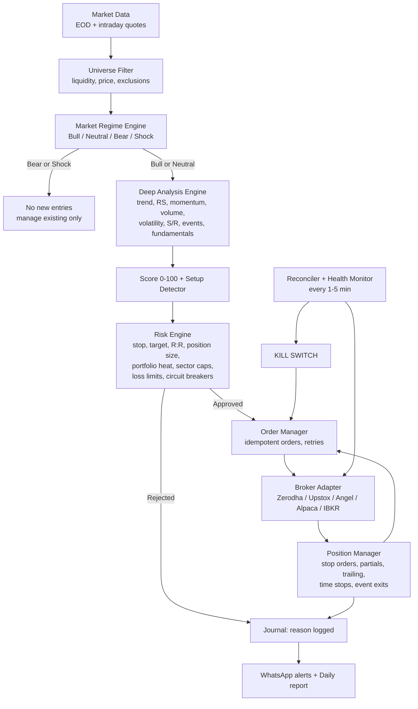

# Automated Swing Trading Bot — Design Plan

> **Status:** Plan approved and decisions answered (Section 16). Version 1 is implemented in `swingbot/`. See the [README](../README.md) for setup and the go-live checklist.

> **Important:** No algorithm can guarantee profits or avoid every loss. This system is designed to do three things well: **protect capital first**, take only high-probability setups, and let winners run while cutting losers quickly. It will have losing trades and losing streaks. That's normal, and the risk rules are built to survive them.

---

## Table of Contents

1. [What the bot does (in one page)](#1-what-the-bot-does-in-one-page)
2. [Trading style and scope](#2-trading-style-and-scope)
3. [System architecture](#3-system-architecture)
4. [Daily operating schedule](#4-daily-operating-schedule)
5. [Stage 1: Stock universe filter](#5-stage-1-stock-universe-filter)
6. [Stage 2: Market regime filter](#6-stage-2-market-regime-filter)
7. [Stage 3: Deep stock analysis and scoring](#7-stage-3-deep-stock-analysis-and-scoring)
8. [Stage 4: Entry setups](#8-stage-4-entry-setups)
9. [Stage 5: Risk management (the core of the system)](#9-stage-5-risk-management-the-core-of-the-system)
10. [Stage 6: Trade management and exits](#10-stage-6-trade-management-and-exits)
11. [Order execution and safety engineering](#11-order-execution-and-safety-engineering)
12. [Backtesting and validation](#12-backtesting-and-validation)
13. [Monitoring, alerts and journal](#13-monitoring-alerts-and-journal)
14. [Technology stack and project structure](#14-technology-stack-and-project-structure)
15. [Development roadmap (phases)](#15-development-roadmap-phases)
16. [Decisions needed from you](#16-decisions-needed-from-you)
17. [Legal, regulatory and disclaimer](#17-legal-regulatory-and-disclaimer)

---

## 1. What the bot does (in one page)

Every trading day the bot runs this pipeline:

1. **Filters the market:** it narrows thousands of stocks down to a liquid, tradeable universe of about 200–500.
2. **Reads the market regime:** it decides whether the overall market is bullish, neutral or bearish. In a bear market it stops opening new long trades.
3. **Analyses each stock in depth:** trend on weekly and daily charts, relative strength against the index, momentum, volume, volatility, support/resistance, upcoming events and basic fundamentals. Each stock gets a score from **0 to 100**.
4. **Looks for a specific entry setup**, such as a pullback in an uptrend or a breakout from a base. A high score alone is not enough.
5. **Runs the risk engine:** it calculates the stop-loss, the target, the reward-to-risk ratio and the position size. It also checks portfolio limits. **Any trade that fails any risk rule is rejected.**
6. **Places the order** through your broker's API. **A stop-loss is placed on the broker side immediately after the fill.**
7. **Manages the open trade:** it takes partial profit, moves the stop to breakeven, trails the stop and exits on target, stop, time or trend break.
8. **Logs and reports everything** in a trade journal and sends you a WhatsApp message for each action, plus a daily summary.
9. **Includes circuit breakers:** daily, weekly and monthly loss limits, drawdown limits and a manual **kill switch**.

---

## 2. Trading style and scope

| Item | Proposed setting | Why |
|---|---|---|
| Holding period | 3 to 20 trading days (typical 5–10) | Swing trading captures one "swing" of a trend |
| Primary timeframe | Daily candles | Less noise than intraday and suitable for automation |
| Context timeframe | Weekly candles | Only trade in the direction of the bigger trend |
| Execution timeframe | 5–15 min candles (optional) | Better entry timing and avoids opening-bell volatility |
| Direction | **Long only** (initially) | Simpler and safer. Short swing trades in cash equity are restricted in many markets |
| Instruments | Cash equity / delivery only | **No leverage, no margin, no F&O** in version 1 |
| Max open positions | 5–8 | Diversified but still manageable |
| Trade frequency | About 2–8 new trades per week | Quality over quantity |

**What the bot will never do (hard-coded):**
- Average down on a losing position
- Widen a stop-loss after entry
- Use margin or leverage
- Hold a position without a stop-loss order at the broker
- Trade on tips, news headlines or social media
- Increase position size after losses ("revenge trading")
- Hold through quarterly earnings (configurable, ON by default)

---

## 3. System architecture



**Key design principles:**
- **Broker-agnostic.** All broker calls go through one adapter interface, so switching brokers does not change any strategy or risk code.
- **The risk engine has veto power.** Strategy code can only *propose* trades. The risk engine decides.
- **The broker is the source of truth.** The bot reconciles its internal state with real broker positions and orders every few minutes.
- **Fail safe, not fail open.** If anything is uncertain (stale data, API errors, mismatched positions), the bot stops opening trades and alerts you. It never guesses.

---

## 4. Daily operating schedule

The example below uses Indian market hours (IST, 09:15–15:30). The scheduler is configurable for any exchange.

| Time | Task |
|---|---|
| **08:30** | Broker login/token refresh, system health checks, reconcile positions, **verify every holding has an active stop order**, check the earnings/corporate-action calendar for held stocks |
| **09:15–09:30** | **No new entries** (opening volatility). Handle gap-downs: if a stock opens below its stop, exit immediately |
| **09:30–15:00** | Watch the planned entries from last night's scan. Trigger entries only when price, volume and timing conditions are met. Monitor open positions every 1–5 min |
| **15:00–15:25** | Close-based decisions, e.g. "exit if the daily close is below the 20 EMA" is evaluated near the close and executed before the bell |
| **15:45+** | Download end-of-day data, recompute indicators, run regime → analysis → scoring → setups, build **tomorrow's trade plan**, update trailing stops, send the **daily report** |
| **Weekend** | Weekly-chart analysis, performance review, parameter health check, data maintenance |

Most of the "thinking" happens **after the close** on complete daily candles. That avoids reacting to intraday noise, which is how professional swing traders work.

---

## 5. Stage 1: Stock universe filter

The goal is to trade only stocks that are liquid, fairly priced and safe to enter and exit.

| Filter | Rule (default, configurable) |
|---|---|
| Liquidity | 20-day average daily traded value ≥ ₹10 crore (or $5M) |
| Price | ≥ ₹50 (or $5); avoid penny stocks |
| Market cap | Large and mid caps first (e.g. NIFTY 500 / S&P 1500 constituents) |
| Exchange surveillance | Exclude ASM/GSM/T2T or similar restricted lists |
| Circuit limits | Exclude stocks that hit upper/lower circuit in the last 5 days |
| Data quality | At least 1 year of clean history; no unexplained gaps |
| Corporate actions | Adjust for splits/bonuses; skip stocks with pending actions in the next 5 days |
| Earnings | Skip new entries if results are due within the next 5 trading days |

Output: about 200–500 tradeable stocks per day.

---

## 6. Stage 2: Market regime filter

Most stocks follow the overall market. Buying good setups in a falling market is the most common way swing traders lose money, so **the market regime controls how aggressive the bot is.**

**Inputs:**
- Benchmark index (e.g. NIFTY 50 / S&P 500) vs its 50-day and 200-day moving averages, and the slope of the 200-day
- **Breadth:** % of universe stocks above their 50-day MA
- **Volatility index** (India VIX / VIX) level and its change
- Distribution days: index down > 0.2% on higher volume, counted over the last 25 sessions

| Regime | Conditions (simplified) | Bot behaviour |
|---|---|---|
| **Bull** | Index > 50 DMA > 200 DMA, 200 DMA rising, breadth > 60% | Normal risk (1%/trade), up to 8 positions, all setups |
| **Neutral / Choppy** | Index near its 50 DMA or MAs flat, breadth 40–60% | Half risk (0.5%/trade), max 4 positions, only A+ setups (score ≥ 80) |
| **Bear** | Index < 200 DMA, breadth < 40% | **No new longs.** Tighten trailing stops on existing positions. Stay in cash |
| **Shock** | Index falls > 3% in a day, or VIX jumps > 30% | **Freeze all new entries for 2–3 sessions** and alert you |

Being in cash during bear phases is a position. It is one of the biggest edges a retail system has.

---

## 7. Stage 3: Deep stock analysis and scoring

Each stock in the universe is analysed on several independent dimensions. Combining them avoids relying on any single indicator.

### 7.1 Hard filters (pass/fail; any failure rejects the stock)

- Price above its 200-day SMA, and the 200-day SMA is not falling
- Weekly trend not in a downtrend (no lower-highs + lower-lows on the weekly chart)
- No earnings or major corporate event within 5 trading days
- Enough "room": nearest major resistance is at least 2× the planned risk away

### 7.2 Scoring model (0–100)

| Factor | Weight | What is measured |
|---|---|---|
| **Trend quality** | 25 | Price > 20 EMA > 50 SMA > 200 SMA; MA slopes; higher highs and higher lows; ADX(14) > 20; weekly trend alignment |
| **Relative strength** | 20 | 3- and 6-month return vs the index and percentile rank vs the universe; RS line making new highs; sector strength |
| **Setup quality** | 20 | How cleanly the stock matches a setup in Section 8: tight base, orderly pullback, volatility contraction |
| **Volume / accumulation** | 15 | Up-days on above-average volume, volume drying up on pullbacks, breakout volume ≥ 1.5× the 50-day average, OBV trend |
| **Reward-to-risk** | 10 | Distance to the next resistance vs distance to a logical stop |
| **Volatility fit** | 5 | ATR% in a sensible band (e.g. 1.5%–5% daily); no erratic gaps |
| **Fundamental and event safety** | 5 | Positive earnings/revenue growth trend (if data is available), no excessive debt flags, no pending events |

**Score bands:**
- **≥ 80:** A+ candidate (allowed in Bull and Neutral regimes)
- **70–79:** A candidate (allowed in Bull regime only)
- **< 70:** Watchlist only, not traded

### 7.3 Indicators used

| Category | Indicators |
|---|---|
| Trend | EMA 10/20, SMA 50/150/200, ADX/DMI, swing-high/swing-low structure |
| Momentum | RSI(14), RSI(2) for pullback depth, MACD histogram, Rate of Change |
| Volume | Volume vs 50-day average, OBV, accumulation/distribution days |
| Volatility | ATR(14), ATR%, Bollinger Band width (squeeze), contraction ranges |
| Structure | Support/resistance from pivots, 52-week high/low distance, base depth |
| Relative | RS ratio vs benchmark, sector RS ranking |

---

## 8. Stage 4: Entry setups

A high score tells us the stock is strong. A **setup** tells us *when* the odds and risk are best. Version 1 uses three well-tested swing setups:

### Setup A: Trend pullback (bread and butter)
- **Context:** strong uptrend (score ≥ 70), stock pulls back to the 20 EMA or 50 SMA
- **Pullback signs:** 3–7 day pullback on **declining volume**, RSI(14) cools to 40–55 without breaking the trend
- **Trigger:** next day trades above the previous day's high (a sign that buyers are back)
- **Stop:** below the pullback swing low, or 1.5–2 × ATR below entry, whichever is more logical
- **Target:** the prior swing high or the next resistance, with at least 2R potential

### Setup B: Base breakout (momentum)
- **Context:** stock consolidates for 3–10 weeks in a tightening range (volatility contraction) near its 52-week high
- **Trigger:** close above the base high with volume ≥ 1.5× the 50-day average. Entry is next day on strength, or intraday after the first 15 minutes if volume confirms
- **Stop:** below the last contraction low inside the base, max 7–8% from entry
- **Filter:** skip if the stock is already > 5% above the breakout point (chasing)

### Setup C: Short-term oversold in an uptrend (mean reversion)
- **Context:** price above the 200 SMA, strong RS
- **Trigger:** RSI(2) < 10 or 3+ consecutive down days into support
- **Exit:** close above the 5-day SMA, or a time stop of 5 days
- **Note:** smaller size, quick trades; used mainly in Bull regime

Each setup is **backtested separately**. Only setups that show a positive edge after costs are switched on in live trading.

---

## 9. Stage 5: Risk management (the core of the system)

> Good swing traders are good risk managers first. The goal is to **stay in the game**: one bad trade, one bad week or one bad month must never seriously damage the account.

### 9.1 Risk per trade

| Rule | Default |
|---|---|
| Risk per trade (Bull regime) | **1.0%** of account equity |
| Risk per trade (Neutral regime) | **0.5%** of account equity |
| Absolute maximum (cannot be configured higher) | 2.0% |

"Risk" means **the amount lost if the stop-loss is hit**, not the position value.

### 9.2 Position sizing formula

```
risk_amount      = account_equity × risk_percent
risk_per_share   = entry_price − stop_price
quantity         = floor(risk_amount / risk_per_share)

Then apply caps:
quantity = min(quantity,
               max_position_value / entry_price,      # max 20% of equity per stock
               0.01 × avg_daily_volume,               # max 1% of daily volume (liquidity)
               available_cash / entry_price)          # never use margin
```

**Worked example:**
- Account equity: ₹10,00,000 → 1% risk = **₹10,000**
- Entry: ₹500, stop: ₹476 (below swing low, about 2 × ATR) → risk per share = ₹24
- Raw quantity = 10,000 / 24 = 416 shares → value ₹2,08,000 = **20.8%** of equity
- The 20% position cap applies → **400 shares** (₹2,00,000); actual risk = ₹9,600 (0.96%)
- Resistance at ₹560 → reward = ₹60/share → **R:R = 2.5 ✅** (minimum is 2.0)
- **Worst case (gap risk):** a 10% overnight gap-down → loss of about ₹20,000 = 2%. The 20% position cap is what limits this damage.

The same math works in any currency.

### 9.3 Stop-loss rules

1. **Every entry has a stop-loss defined before the order is sent.** No stop means no trade.
2. The stop is placed **at the broker** right after the fill (GTT/OCO in India, GTC stop or bracket orders in the US). This way it still works if the bot or server goes down.
3. The stop is placed where **the trade idea is proven wrong** (below swing low or support), checked against ATR so it is not inside normal noise.
4. **Maximum stop distance: 8%** from entry. If the logical stop is further, skip the trade or wait for a better entry.
5. Stops **only move up, never down.**
6. **Gap-down handling:** if the stock opens below the stop, exit at market in the first minutes. Do not wait and hope.

### 9.4 Reward-to-risk filter

- **Minimum 2:1** reward-to-risk at entry, measured to the nearest real resistance
- Why this matters: with 2:1, the system is profitable even if only **40%** of trades win

```
Expectancy = (Win% × Avg Win) − (Loss% × Avg Loss)
Example:     (0.45 × 2.2R) − (0.55 × 1R) = +0.44R per trade
At 1% risk per trade: about +0.44% of the account per trade on average, before costs
```

### 9.5 Portfolio-level limits

| Rule | Default |
|---|---|
| Max open positions | 8 (Bull), 4 (Neutral), 0 new (Bear) |
| **Portfolio heat** (sum of open risk of all positions) | **≤ 6%** of equity |
| Max per sector | 2 positions or 30% of equity |
| Correlation check | Reject a new trade if its 60-day correlation with an existing position is > 0.8 |
| Max capital deployed | 100% of cash; never margin |
| New entries per day | Max 3, to avoid getting caught in a single bad day |

### 9.6 Circuit breakers (loss limits)

| Trigger | Action |
|---|---|
| Daily loss ≥ **2%** | Stop new entries for the rest of the day |
| Weekly loss ≥ **4%** | Stop new entries until next week; alert you |
| Monthly drawdown ≥ **8%** | Halve risk per trade for the next month |
| Drawdown from equity peak ≥ **15%** | **Full stop**: no new trades. Existing positions are managed by stops only. Needs **your manual review and restart** |
| 3 consecutive losses | Cut risk per trade by 50% until 2 winning trades |
| Equity curve below its 20-trade moving average | Trade at half size until it recovers |

**Why this matters:** at 1% risk, 10 losses in a row (which will happen sometime) costs about **9.6%**. At 5% risk, the same streak costs **40%**, and you need +67% just to get back to break-even.

### 9.7 Event and gap risk

- Exit or skip positions **before quarterly results** (default: exit 1 day before)
- Track board meetings, splits, dividends, index rebalances
- Reduce overall exposure before known high-risk macro events (central bank policy days, budget day, elections), configurable
- Limit position size so a 10–15% gap costs at most about 2–3% of the account

### 9.8 Cost and slippage awareness

- Brokerage, transaction taxes (e.g. STT, stamp duty, exchange fees, GST in India), and slippage are **included in every backtest and every R:R calculation**
- Rough budget: about 0.25–0.35% round trip for liquid Indian delivery trades (this varies by broker)
- Trades where costs eat more than 10% of the expected reward are rejected

### 9.9 Operational risk (technology can fail too)

| Risk | Protection |
|---|---|
| Bot/server crash | Stops are held **at the broker**, so positions stay protected |
| Duplicate orders | Every order has a unique idempotency key; position checks before every order |
| Stale or bad data | Data freshness and sanity checks (price jumps, zero volume); halt if they fail |
| Broker API down | Retry with backoff, then safe mode (no new entries) + alert |
| Stop order placement fails after a fill | Retry 3× → if still failing, **exit the position at market** + urgent alert. **The bot never holds an unprotected position** |
| Position mismatch with broker | Reconciler runs every 1–5 min; any mismatch → halt new trades + alert |
| Runaway loop / bug | Hard caps: max orders per day, max orders per minute, max position value |
| Credentials leak | API keys in environment variables / secret store, never in code or git; static IP whitelisting |
| Anything unexpected | **Kill switch** (`python -m swingbot kill`, or the `state/KILL` file; turns on automatically after repeated errors): cancels pending orders and blocks all new orders immediately |

---

## 10. Stage 6: Trade management and exits

Each open position follows a written plan:

```
ENTRY ─► Initial stop placed at broker (−1R)
  │
  ├─ Price reaches +1R  ─► Move stop to breakeven (entry + costs)
  │
  ├─ Price reaches +2R  ─► Sell 1/3 to 1/2 of position (lock profit)
  │                        Trail the rest
  │
  ├─ Trailing stop (whichever is tighter and logical):
  │     • Daily close below 20 EMA (for strong trends: 10 EMA)
  │     • Chandelier stop: highest high (22) − 3 × ATR(22)
  │
  ├─ Target / resistance reached with weakness ─► Exit the rest
  │
  ├─ TIME STOP: no progress to +1R within 10 trading days ─► Exit
  │
  ├─ EVENT EXIT: earnings within 1 day ─► Exit
  │
  └─ REGIME EXIT: market turns to Bear/Shock ─► Tighten all stops
```

**Exit priorities:** (1) stop-loss hit, (2) event/regime emergency, (3) trailing stop, (4) target, (5) time stop.

---

## 11. Order execution and safety engineering

### 11.1 Order types

| Purpose | Order type |
|---|---|
| Pullback entry | Limit order slightly above the trigger (e.g. +0.1–0.2%) to control slippage |
| Breakout entry | Stop-limit / buy-above trigger with volume confirmation |
| Stop-loss | Broker-side **GTT / OCO** (India) or **GTC stop** (US). Persists overnight, survives bot downtime |
| Profit-taking | Limit order at target, or OCO paired with the stop |
| Emergency exit | Market order (or aggressive limit) |

### 11.2 Order state machine

```
SIGNAL → [APPROVAL*] → ORDER_SENT → FILLED / PARTIAL / REJECTED
FILLED → STOP_PLACED → MANAGING → EXIT_SENT → CLOSED
(*APPROVAL step only in a semi-auto mode; you chose fully automatic, so it is skipped)
```

- Partial fills: stop is placed for the filled quantity; unfilled remainder is cancelled at a cut-off time
- No entry orders in the first 15 minutes or the last 10 minutes of the session
- Every state change is written to the database **before and after** the broker call, so recovery after a crash is exact

### 11.3 Pre-trade checklist (enforced in code; all must pass)

- [ ] Kill switch is off, and no circuit breaker is active
- [ ] Regime allows new entries
- [ ] Score ≥ threshold for the current regime
- [ ] Setup trigger confirmed
- [ ] Stop defined, distance ≤ 8%, R:R ≥ 2.0 after costs
- [ ] Position size within all caps (risk, position %, liquidity, cash)
- [ ] Portfolio heat after this trade ≤ 6%
- [ ] Sector and correlation limits OK
- [ ] No earnings/event within 5 days
- [ ] Not already holding this stock; no pending order for it
- [ ] Data is fresh; broker connection is healthy

---

## 12. Backtesting and validation

**No strategy goes live until it passes this stage.** This is where most "great ideas" fail, and it's better they fail here than with real money.

### 12.1 Method
- **10+ years** of daily data including bad periods (2008, 2015–16, 2020 crash, 2022 bear)
- **Survivorship-bias-free** universe where possible (include stocks that were delisted)
- Realistic **costs + slippage**, next-day execution (no look-ahead bias)
- **Walk-forward testing:** optimise on one period and test on the next unseen period, rolling forward
- **Out-of-sample hold-out:** the last 2 years are never used for tuning
- **Monte Carlo simulation:** reshuffle the trade order 1,000+ times to see the realistic range of drawdowns
- **Parameter robustness:** performance must stay reasonable when parameters change ±20%. If it only works with exact numbers, it's curve-fitted

### 12.2 Acceptance criteria to go live

| Metric | Minimum requirement |
|---|---|
| Number of trades | ≥ 200 |
| Profit factor (after costs) | ≥ 1.5 |
| Expectancy | ≥ +0.25R per trade |
| Max drawdown | ≤ 20% |
| Monte Carlo 95th-percentile drawdown | ≤ 30% |
| Out-of-sample vs in-sample performance | ≥ 70% |
| Beats buy-and-hold index on risk-adjusted basis (Sharpe/Sortino/MAR) | Yes |

### 12.3 Paper trading
- **2–3 months** of paper (simulated) trading with live data and the full pipeline
- Results should fall within the expected range from the backtest
- **Zero operational errors:** no unprotected positions, no duplicate orders, no missed exits

---

## 13. Monitoring, alerts and journal

- **WhatsApp alerts:** a message for every order, fill, stop move, exit and error, plus a morning summary. Control is from the command line: `status`, `kill`, `kill --flatten`, `resume`
- **Daily report:** P&L, open positions with current R, portfolio heat, regime, tomorrow's watchlist, any rejected trades and why
- **Trade journal (database):** for every trade it stores the entry reason, score breakdown, setup, stop/target, size, exit reason, R-multiple, chart snapshot, MAE/MFE (max adverse/favourable excursion)
- **Weekly/monthly analytics:** win rate, avg R, expectancy, profit factor, performance by setup/sector/regime, drawdown chart
- **Dashboard (optional, Phase 5):** simple web page with the equity curve and open positions

---

## 14. Technology stack and project structure

| Layer | Choice |
|---|---|
| Language | Python 3.12 |
| Data and indicators | pandas, numpy, pandas-ta / TA-Lib |
| Backtesting | Custom event-driven engine (matches live logic exactly) + vectorbt for fast research |
| Database | SQLite (start) → PostgreSQL (later) |
| Scheduler | APScheduler |
| Broker SDKs | Kite Connect (Zerodha), Upstox API, SmartAPI (Angel One), DhanHQ, Alpaca, IBKR, chosen in Phase 0 |
| Data sources | Broker historical API (primary), exchange EOD bhavcopy files, yfinance (research only) |
| Alerts | WhatsApp (CallMeBot or the Meta Cloud API) |
| Config | YAML files + environment variables for secrets |
| Deployment | Docker on a small cloud VPS with **static IP** (often required by brokers for API trading) |
| Testing | pytest: unit tests for every risk rule; simulation tests for order flows |

### Proposed folder structure

```
swing_bot/
├── config/
│   ├── settings.yaml          # strategy + risk parameters
│   └── .env.example           # API keys template (real .env never committed)
├── bot/
│   ├── data/                  # data providers, EOD downloader, cache, validation
│   ├── analysis/              # indicators, regime, setups, scoring
│   ├── risk/                  # position sizing, portfolio limits, circuit breakers
│   ├── execution/             # broker adapters, order manager, reconciler
│   ├── portfolio/             # positions, trailing stops, exit logic
│   ├── backtest/              # engine, metrics, walk-forward, Monte Carlo
│   ├── notify/                # WhatsApp alerts
│   ├── journal/               # DB models, reports
│   ├── scheduler.py           # daily schedule
│   └── main.py                # entry point (modes: backtest / paper / live)
├── tests/                     # risk rules tested first and most thoroughly
├── notebooks/                 # research
├── Dockerfile
└── README.md
```

### Sample risk configuration (`settings.yaml`)

```yaml
mode: paper                 # backtest | paper | semi_auto | live

risk:
  risk_per_trade_pct:
    bull: 1.0
    neutral: 0.5
    bear: 0.0
  max_risk_per_trade_pct: 2.0        # hard ceiling
  max_position_pct: 20
  max_stop_distance_pct: 8
  min_reward_risk: 2.0
  max_portfolio_heat_pct: 6
  max_positions: { bull: 8, neutral: 4, bear: 0 }
  max_per_sector: 2
  max_correlation: 0.8
  max_new_entries_per_day: 3
  max_adv_participation_pct: 1

circuit_breakers:
  daily_loss_pct: 2
  weekly_loss_pct: 4
  monthly_drawdown_pct: 8
  peak_drawdown_halt_pct: 15
  losing_streak_reduce: 3

exits:
  breakeven_at_r: 1.0
  partial_at_r: 2.0
  partial_fraction: 0.5
  trail: ["ema20_close", "chandelier_3atr"]
  time_stop_days: 10
  exit_before_earnings_days: 1
```

### Core decision loop (pseudo-code)

```python
def end_of_day_scan():
    regime = regime_engine.evaluate(index_data, breadth, vix)
    if regime in (BEAR, SHOCK):
        portfolio.tighten_stops(); notify(regime); return

    universe = universe_filter.run(all_stocks)
    candidates = []
    for stock in universe:
        if not hard_filters.pass_all(stock):
            continue
        score = scorer.score(stock)                 # 0–100 with breakdown
        setup = setup_detector.find(stock)          # A / B / C or None
        if setup and score >= threshold[regime]:
            candidates.append(plan_trade(stock, setup, score))

    for plan in rank_by_score(candidates):
        decision = risk_engine.evaluate(plan, portfolio, regime)  # veto power
        journal.log(plan, decision)
        if decision.approved:
            trade_plan_for_tomorrow.add(plan.with_size(decision.quantity))

    notify.daily_report(regime, portfolio, trade_plan_for_tomorrow)
```

---

## 15. Development roadmap (phases)

Each phase has a clear finish line. We move to the next phase only when the current one passes.

| Phase | Deliverable | Finish line |
|---|---|---|
| **0. Decisions** | Broker, market, capital, mode (see Section 16) | Your answers |
| **1. Data + analysis engine** | Data pipeline, indicators, regime engine, scoring, setup detector | Daily watchlist report with score breakdowns that you can check by hand |
| **2. Risk engine** | Position sizing, all portfolio limits, circuit breakers, with full unit tests | 100% test coverage on risk rules |
| **3. Backtester + validation** | Event-driven backtest, walk-forward, Monte Carlo, reports | Strategy meets the acceptance criteria in 12.2 |
| **4. Broker integration + paper trading** | Broker adapter, order manager, reconciler, WhatsApp alerts | 2–3 months of paper trading with zero operational errors |
| **5. Live: small and semi-auto** | Live with 10–20% of intended capital; fully automatic with all safety latches (your choice) | 1–2 months where live results match paper/backtest |
| **6. Full automation** | Auto-execution with all safeguards; scale capital gradually | Ongoing monitoring and monthly reviews |

---

## 16. Decisions needed from you

**Answered.** Here is how the design adapted to each answer:

| Question | Your answer | What the bot does |
|---|---|---|
| Market and broker | Groww and Zerodha | Both adapters are built. **Groww is recommended for execution** because its official API logs in with TOTP, so no human step is needed each day. Zerodha's Kite Connect needs one login tap every morning; the bot sends you the link on WhatsApp. |
| Capital | ₹10,000 trial | A "micro" risk profile (below). `live_capital_limit: 10000` keeps the bot inside a ₹10k "sub-account" even if your broker account holds more money. It never touches shares you bought yourself. |
| Risk tolerance | "Decide yourself" | Micro profile: **2% risk per trade (₹200)** in bull markets, 1% in neutral markets, 0 in bear markets. Max 2 positions, max ₹5,000 per position, max 4% total open risk, 15% drawdown halt. Partial profit-taking is off, because each extra sell costs a DP charge. The profile switches to 1.25% and then 1% risk automatically as equity grows past ₹50k and ₹5L. |
| Automation | Fully automatic | No approval step. The safety latches move into code instead: broker-side OCO stops, circuit breakers, a kill switch, at-most-once orders, a stale-data guard, and auto-kill after repeated errors. |
| Stocks | "Best trade setup" | NIFTY 500 universe, filtered by liquidity. Only setups that score at least 70 (bull) or 80 (neutral) **and** pass every risk rule are traded. |
| Alerts | WhatsApp | CallMeBot (free, personal) or the Meta WhatsApp Cloud API. Every alert is also written to `state/alerts.log`. |

**Follow-up: "I want free swing trading."** Added a **₹0 signal mode** (`python -m swingbot signals`). It runs the same analysis and risk engine, then sends the exact orders on WhatsApp for you to place in the app. It needs no server, no broker API and no static IP. It runs on GitHub Actions or a laptop, and Zerodha charges ₹0 brokerage on delivery. Your positions are kept in `journal/`.

**Design changes made during implementation:**
- **Decisions are made after the close; orders are held by the broker.** Entries are stop-limit BUY orders valid for one day. Stops and targets are broker-side OCO orders: GTT two-leg on Kite, a smart OCO order on Groww. The bot therefore needs only end-of-day data. Positions stay protected even if the server goes down.
- **Close-based exits run at the next open.** Trend breaks and time stops are decided on the completed daily candle and executed at the next morning's open. This matches the backtester exactly.
- **SEBI static-IP rule (in force since 1 April 2026).** The bot must run on a server with a static IP that you register with your broker.
- **Mean-reversion setup is off for the micro account.** Its small average win is eaten by charges.

## 17. Legal, regulatory and disclaimer

- **India:** SEBI introduced a framework for retail algorithmic trading through broker APIs (2025 circular, being phased in). It covers things like static IP registration, order-rate limits and algo registration/tagging through the broker. Exact requirements depend on your broker and the current rules, so **we will confirm them with your broker before going live.** Also check your broker's API terms, especially around automated login.
- **US:** Check pattern-day-trader rules if a position is opened and closed on the same day (rare for swing trading, but possible when a stop triggers on entry day), and broker API terms.
- **Taxes:** Short-term capital gains apply to swing trades; the journal will export a trade report to help with tax filing.
- **Disclaimer:** This is a software tool, not investment advice. Trading involves the risk of losing money. Past and backtested performance does not guarantee future results. Only trade with capital you can afford to lose, and keep the bot under your supervision.
